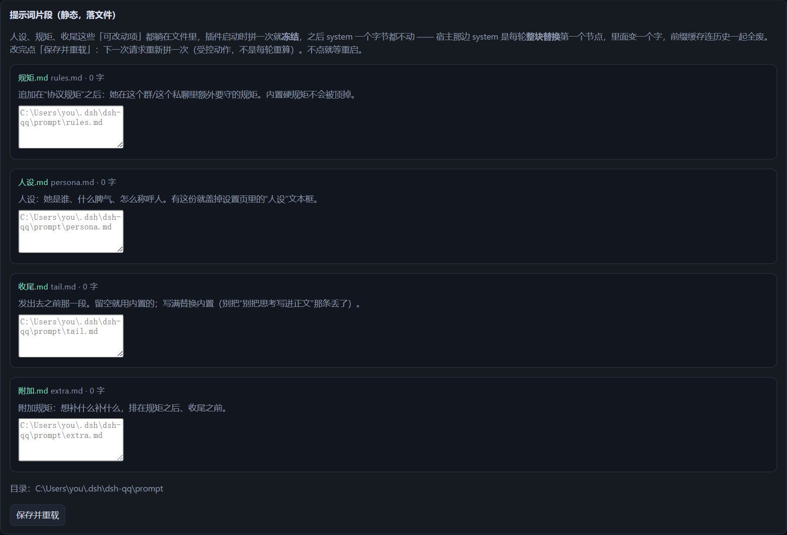

# dsh-qbot

把 **QQ** 接成 [DeepSeek Harness](https://github.com/deepseek-ai/dsh) 的一个前端：私聊、群聊都能和同一个 Agent 聊；它听得懂语音、看得见图片，会发表情包，也会烦、会闹、会甩脸色。

底层走 [OneBot v11](https://github.com/botuniverse/onebot-11) 协议，默认搭配 [NapCat](https://napneko.github.io/)。不用公网 IP、不用备案、不用企业主体。


> ⚠️ **先说清楚**：NapCat 属于「QQ 协议端」，跑在你自己登录的 QQ 客户端上，**不符合腾讯的用户协议**。用小号、别和常用号同一台设备、别发垃圾消息，账号有被风控或封禁的可能。插件只负责把 OneBot 消息转给 Agent，协议端本身怎么合规、怎么稳，由你自己负责。场景能用 [QQ 官方机器人](https://bot.q.qq.com/) 的，优先用官方的。

> 📢 **这是个人自用改出来的版本**：MIT，随便取用、改、再发。没有客服、没有 SLA。
> 提 issue 或贴日志之前，请先把 **token、真实 QQ 号、本机路径** 抹掉——发出去就收不回来了。

---

## 关于这个 fork

**本插件不是从零写的。** 它 fork 自 [**dsh-qq-onebot**](https://github.com/2710586329/dsh-qq.git)（早期名 `dsh-qq`），原作者 **xier**，MIT 许可。

上游把「OneBot 11 / NapCat ↔ DSH Agent」这条链路的骨架搭得很扎实——WebSocket 连接与重连、私聊/群聊各一条持久会话、每会话独立工作目录、语音转写、图片落地、审批与问答通道、长文本分条、限速与间隔，这些**都是原作者的功劳**。这个 fork 站在上面继续改。

改它的原因很朴素：我把它当日常在用的机器人养，养出了原版没有的一堆需求，于是一层层加上去，最后长成了现在这样。

| 方向 | 这个 fork 做了什么 |
| --- | --- |
| **提示词分层** | system 完全静态化：只留 `rules` / `persona` / `tail` 三段，首轮算完逐字节冻结；每轮会变的事实卡、群词典、话头、表情包策略、当前烦躁度全部搬到 runtime-context，不再每轮把 system 顶掉、不再让前缀缓存整块失效 |
| **群聊脾气** | 最早只是为了在被刷屏骚扰时**完全屏蔽、省掉无谓的 token**（只有主人能 @ 回来）；后来演变成烦躁度曲线、三档阈值、两种行为模式（幸福者退让 / 必须回击）、无视冷窗，因为这样更有意思；四段提示词模板可按群改写；面板里能看实时曲线 |
| **群聊设置页** | 三十多项**按群单独覆盖**，默认跟随全局：触发、节奏、烦躁度、提示词、表情包、白嫖请求、命令通道；一次保存立刻生效 |
| **表情包** | 从「按名字四级匹配」换成**语义检索**：每张图有描述和向量，按意思挑图；发不发的闸从提示词搬进工具管道（两张间隔 / 每小时上限，全局 + 按群配）；收藏可视化——四列缩略图、点开改描述重算向量、增删、上传 |
| **对话窗口** | 按「群 + 人」开窗，时长可分群设，续期开关两段式；到点收尾只交「该回却没回」的消息，不会把别人的闲聊顺手接走 |
| **热窗 / 冷窗** | 换档用精确 `setTimeout` 而不是 15 秒轮询；冷窗攒消息连图一起带回来；热窗收尾只冲刷被压住的那几句 |
| **提示词片段落文件** | `<DSH_HOME>/dsh-qq/prompt/{rules,persona,tail,extra}.md`，设置页四个文本框 + 「保存并重载」，不改代码就能调规矩 |
| **每会话独立工作区** | 每个群 / 每个私聊一份 `AGENTS.md` + `记忆区/`，日记、群词典、话头都在里面，互相看不见 |

**内部标识没跟着改名**：日志前缀 `[dsh-qq]`、HTTP 路由 `/api/dsh-qq/*`、配置目录 `$DSH_HOME/dsh-qq/`、提示词 section 名 `dsh-qq:*` 沿用上游。这是故意的——从上游换过来时，旧的设置文件、表情包收藏、会话目录能直接复用，不用搬家。**包名和插件显示名是 `dsh-qbot`，跟这些内部标识不冲突。**

上游的 bug、想给上游提 PR，请去 [原仓库](https://github.com/2710586329/dsh-qq.git)；这个 fork 特有的东西在这里说。

---

## 它能干什么

| 特性 | 说明 |
| --- | --- |
| 一个 QQ 会话 = 一个持久 Agent 会话 | 有历史、有记忆，不会聊两句就忘 |
| 每个会话一个独立工作目录 | 自带 `AGENTS.md` 和 `记忆区/`，彼此看不见，也碰不到宿主自己的私人记忆 |
| 语音转文字 | 本地 vosk 离线识别，不联网、不上传，结果直接进对话 |
| 群里默认 @ 才理 | 被 @ 过一次后开一段对话窗口，窗口内不用再 @（窗口按「群 + 人」算，别人蹭不到） |
| 分得清谁在跟自己说话 | 引用算叫我、`[SILENT]` 可以不接、同类机器人单独开关、跳过的话也进上下文 |
| 有脾气 | 被刷屏骚扰时能**完全屏蔽**（只有主人 @ 得回来），烦躁度是一个连续量、可以一直看曲线；过阈值会摆脸色、会进无视冷窗 |
| 会怼白嫖 | 认出「让他替你干活」的请求，按群选择允许 / 拒绝 / 惩罚（惩罚 = 拒绝 + 加烦躁度 + 骂回去） |
| 会发表情包 | 语义检索挑图，按意思找；发不发由它自己定 |
| 不会把自己聊丢 | 窗口快满时补回聊天规矩；再撑满就换新会话，旧的最近聊天先落盘再接上 |
| 十几个互动工具 | `qq_send` / `qq_reply` / `qq_send_image` / `qq_send_file` / `qq_mface` / `qq_face` / `qq_faces` / `qq_keep_face` / `qq_poke` / `qq_react` / `qq_like` / `qq_recall` / `qq_images` / `qq_group_history` / `qq_glossary` / `qq_facts` / `qq_pin` / `qq_meme` |
| 问答能转回 QQ | `ask_user_question` 抛的问题会变成一条 QQ 消息，回个数字就行 |

> 🧠 **推荐搭配 [dsh-context-ctl](https://github.com/Mrapple051108/DSH-Context-Control)**
>
> QQ 会话是最典型的长期会话——一个群能连着聊几个月，历史长得飞快，于是**每一轮都在为几个月前的寒暄付费**。
> 那个插件按会话把模型视野（surface）里的旧历史换成一句替身，只留最近几条原文：**不调 LLM、不动会话日志、不改 web 记录**，
> 被裁的原消息一条不少，记忆库里照样查得到。群聊和私聊可以分别开，默认全关，一个会话一个开关。
>
> 它和本插件自带的 `contextGuard` **不抢地盘**：`contextGuard` 管的是「再长就装不下」的急救（写记忆 → 换新会话 → 用便签接上），
> dsh-context-ctl 管的是「日常太长了，把旧的裁掉」。一个急救，一个节流，可以同时开。

> 🧠 **再配一个 [fast-ivf-rag](https://github.com/Mrapple051108/DSH-Fast-IVF-RAG)，把记忆真正存下来**
>
> 上面那个负责**裁**，这个负责**裁掉之后还记得**。群聊连着聊几个月，历史必然长到要裁；但被裁掉的东西不该真忘——
> 它们会变成一条条几十字的记忆节点存进本地向量库（IVF 聚类 + BM25 混合检索），需要时按语义捞回来。
>
> **热路径 6~8 ms**，快到能当工具用：`rag_search` 和 `read` 摆在一起，模型想翻旧账随时调，不会卡住回复；
> 平时每轮还会自动召回一次，命中几条就以几十字的长度注入上下文。
>
> 三个东西的分工：**dsh-qbot 负责说话，dsh-context-ctl 负责裁短，fast-ivf-rag 负责不忘记。**

---

## 界面一览

DSH 侧栏里有一页「**群聊状态与设置**」，两个 tab。截图里的群号、QQ 号、本机路径都换成了假值，表情包缩略图打了马赛克。

### 状态：这一刻它在想什么

（上面那张大图就是。）

六张卡片，都是实时值：

- **当前相位** —— 热窗还是冷窗，这一档抽到了多长时间，区间是多少；
- **烦躁度** —— 0~100 的连续量，底下写着「本条打分 28.1 · 阈值 75」，能看出是哪句话把它顶上去的；
- **情绪** —— 由烦躁度换算成的档位：平静 / 烦躁 / 愤怒 / 跑路 / 跑路中；
- **换档倒计时** —— 精确到秒，到点真的会变（不再靠 15 秒轮询）；
- **攒着 / 丢弃** —— 冷窗里压着几条没交出去、丢过几条；
- **接话节奏** —— 这一轮它打算等多久再回（跟烦躁度走，越烦越拖）。

底下的曲线 15 秒落一个点，相位切换时额外补一个；三条横线就是三个阈值。**它是纯观测量**——关掉「按烦躁度自动开无视」只是不再自动进冷窗，分数照算，曲线照画。

### 群设置：每一项都能只对这一个群生效


左边那一列勾选框是「**跟随全局**」。勾着的时候读全局值、改不动；取消勾选才落到这个群的 `groupOverrides` 里，保存即刻生效，不用重启。

覆盖不是深合并，是**按 key 缺省**：没写就是跟随，写了就以这个群为准。


### 表情包收藏：全局一份


所有群和私聊共用同一份收藏——表情包没有按群的概念。四列缩略图，点任意一张打开详情。


详情里能改**描述**和标签，保存时会**重算这张图的语义向量**，下次按意思挑图就按新描述找。描述留空的图语义检索挑不到，只能靠手动指定。删除会连本地图片一起删掉；商城表情只删这份登记，不影响 QQ 里的表情。

### 提示词片段：不改代码也能调规矩



四个文件摊在页面上，改完点「保存并重载」，下一次请求就按新内容拼。空着就用内置的。

---

## 设计介绍

这一节不列功能，讲**为什么长成这样**。

它不是一个先设计好再实现的插件——是在一个真实群聊里养出来的。下面每一条背后都有一次具体的事故、一张账单、或者一句「这样不好玩」。

### 先说前提：群聊的每一句话都要花钱

普通聊天机器人是「来一条消息 → 调一次模型」。放在群里，这就是最贵的一种形态：**哪怕它最后一个字都不说，那一轮的 system prompt、人设、历史、工具定义也照烧不误**。

一个几十人的群，一天几百条消息，如果每条都投给模型「看一眼再决定要不要回」，账单是灾难性的，而且绝大多数轮次的产出是 `[SILENT]`——花了几毛钱换来一个「已读」。

所以这个插件从第一版改造起就守一条原则：**能在进模型之前判断的，绝不留到模型里判断**。下面几乎所有的设计，都是这条原则的变体。

---

### 一、节奏：热窗 / 冷窗 —— 先解决「钱」，顺便解决「吵」

最早它被 @ 一次之后就永久开着耳朵，群里每句话都会被读一遍。2026-11-01 那次的原话是：

> 「现在完全依赖模型自觉，让模型自己决定回不回，实际上只是不吵但还是会有开销。」

于是有了三态：

| 态 | 它干什么 | 花不花钱 |
| --- | --- | --- |
| **热窗**（90~150 秒） | 消息照常投递，正常回 | 花 |
| **冷窗**（10~20 分钟） | 消息只**攒着**，一条都不投 | **不花** |
| **无视冷窗** | 消息直接**丢**，只留几条尾巴 | **不花** |

冷窗到点，把攒下的那一批一次性交出去（连图一起，不然它只看得到一行 `[图片]`）。冷窗期间被 @ 会立刻打断、带着攒的消息回到热窗。

私聊不走这套——一对一攒 20 分钟才回太反人类了。

**后来补的一刀**：只有 15 秒一次的轮询，倒计时归零后最坏还要再等 14 秒才真的换档，页面上「还剩 3 秒」说完就干瞪眼。现在按 `untilAt` 排精确 `setTimeout`，轮询只当兜底。

---

### 二、烦躁度：从「不想理人」长成一套脾气

**最初的目的很单纯：躲。**

群友不停地 @ 它、刷屏、复读，每一轮都是钱。所以要有个开关，让它**完全屏蔽这个群的消息和 @ 请求**，安静待着——但有一个人例外：**主人随时能 @ 回来**。

这就是「无视冷窗」的本体，`ignoreAuto` 一开，攒够分就自动进去。进去之后谁说话都当没听见，只有主人的 @ 能把它拽出来。

**后来的演变，主要是因为它变好玩了。** 一个二元开关（烦 / 不烦）太无趣，于是：

1. **从开关变成连续量**。每条消息按四项加权打个分（冗余度 50 / @ 频率 20 / 纠缠度 10 / 复读连击 25），平滑进一个 0~100 的 `ignite`，没人说话时按时间常数衰减。它现在是一个**有惯性、会自己消气**的东西，不是布尔值。
2. **从一档变成三档**。冷静 / 愤怒 / 逃离，三个阈值。越过愤怒只触发一次（边沿触发，不然每句话都骂一句，那不叫脾气叫复读机），掉回冷静以下才重新武装。
3. **给它性格**。同样的分数，两种演法：`yield`（幸福者退让）是嫌弃、甩脸、「不理你了」，不带脏字；`fight`（必须回击）是直接开骂。四段提示词模板都能改，`{v}` 会换成当前分数。
4. **给它曲线**。线性太单调，于是有 `fast-slow`（一点噪音就上去，但很难顶满）和 `slow-fast`（前面忍很久，一旦开始烦就断崖式上升）。同一套阈值，换个曲线就是另一种性格。
5. **必须能看见**。不能观察就没法调——所以有了那张实时曲线图，15 秒一个点，相位切换时额外补点。
6. **最后发现：它自己不知道。** 有人问「烦躁度是怎么反馈给它的，我发的消息里没看到相关提示」——一问才发现，以前只有「冷窗到期回填」和「无视结束回填」两条路会带这个信息，**正常聊天里它压根不知道自己烦到哪儿了**，那「按烦躁度表达态度」就是一句空话。现在每轮的动态提示段里都带着当前分数和档位。

> 「进无视前先放一句话再走」（比如「你们好吵啊，我要静音了」）是后来加的：无声无息地不理人像掉线，说一句再消失才像生气。

---

### 三、白嫖请求：正则 + 惩罚 —— 因为真的有人在刷

2026-11-02 那天的日志：一个群 **173 条消息**，其中大量是这样的：

```
@机器人 原神11月剧诗月谕模式一图流攻略
@机器人 发图片
@机器人 绘制同步发电机的相量图
@机器人 绘制原神7.2幽境危战攻略图
```

每一条都是一轮完整调用，产出多半是「查不到」或者瞎编。这不是聊天，是把它当免费劳动力使。

**判据只有一条：产出型。** 让你画图、查资料、算东西、写代码、翻译长文——这是「替他干一份活」；而「这个报错怎么修」「你为什么不动了」是**求助 / 搭话**，不是白嫖。把真心求助的人也骂了，那才是人设崩。所以内置表只认产出型动词，宁可漏判也不误伤。

命中之后三档策略，按群选：

| 策略 | 效果 |
| --- | --- |
| `allow` | 不管，照常回 |
| `refuse` | 拒绝，但是好好说 |
| **`punish`** | 拒绝 + **砸一笔烦躁度**（默认 +35）+ 骂回去 |

`punish` 是这次改造的重点：**它不只是拦下来，它借这个机会发火**。烦躁度被顶上去，后面的态度跟着变差，烦够了就自己进无视冷窗——整条链是通的：被白嫖 → 生气 → 骂 → 走人。

正则可以按群追加（`requestPatterns`，一行一条，写错的行会被跳过并告诉你），因为不同群的骚扰形态不一样。

---

### 四、对话窗口：@ 之后理你多久

@ 一次就永久开着耳朵显然不行；@ 一次只回一句又太死。所以有一个**固定时长的窗口**：

- 窗口**按「群 + 人」开**——原来按群记，只要有一个人 @ 一次，群里任何人说话它都接；现在只有当初 @ 它的那个人能续期、能蹭用，别人说话既不能续期也不能蹭。
- 引用它、被点名、被叫名字，都算「被叫了」，一样开窗。
- 窗口到点会**收个尾**：把还没回的话摆到它面前，让它自己说一句「先去忙了，有事 @ 我」——不想说就 `[SILENT]`，不硬塞台词。
- 是否每次 @ 都刷新窗口，是个可配的开关（`groupWakeRenew`）。关掉之后第一次 @ 的计时说了算，窗口才真的关得掉。

> 1.3.2 修的一个坑正好在这条链上：窗口关掉之后它还在回话。原因是「热窗收尾」把整个上下文缓冲（里面混着**别人的闲聊**）都当成「它压着没回的话」一起端了出去。现在两个账分开：`backlog` 是别人的话（只当上下文），`pending` 才是真被压住该回的。跳过 ≠ 要回，这两件事以前被混在一起了。

---

### 五、提示词必须是静态的

这条是踩出来的。原来的做法是每轮现拼 system，里面塞了事实卡、群词典、话头、表情包清单——看着很聪明，实际上：

> 宿主每轮会把 system 的**第一个节点整块替换**。里面只要有一个字跟上一轮不同，前缀缓存从第 0 字节起全部失效，**连后面的历史一起作废**。

也就是说，为了让提示词「更实时」，把每轮的缓存收益全扔了。而现在的事实卡、表情包清单这些**每个小时都可能变**的东西，放进 system 就是纯粹的浪费。

所以现在分两层：

| 层 | 挂哪儿 | 内容 | 变化频率 |
| --- | --- | --- | --- |
| **静态** | `systemPrompt.section` | 行为规矩 / 人设 / 收尾自检 | 首轮算完**冻结**，逐字节不变 |
| **动态** | `systemPrompt.context` | 事实卡、群词典、话头、群纸条、表情包策略、当前烦躁度 | 每轮重建，塞在真实用户消息**之前**，不进 system、不进历史 |

动态那条走 `runtime-context`，位置固定在真实发言前，`dsh-context-ctl` 这类压缩插件也不会把它当成用户发言摘进摘要。

---

### 六、提示词落成文件

接着上一条：既然 system 不能每轮变，那「改规矩」就得有个明确的动作，而不是「改配置 → 下一轮自动生效」。

于是四个片段落盘：

```
<DSH_HOME>/dsh-qq/prompt/
  rules.md    追加在内置硬规矩之后（不能替换，免得把安全网拆了）
  persona.md  人设，存在就优先于配置里的 persona
  tail.md     收尾自检，存在就整体替换内置那段
  extra.md    附加规矩
```

读取按 `mtime + size` 记忆：文件没动就不重读、不重算，保证同一个配置状态下 system 逐字节一致。**改完要重启（或点设置页的「保存并重载」）**——这是故意的，每轮重拼就等于 system 每轮变，缓存全废。

设置页给了四个文本框，就是为了让「改规矩」这件事不用打开代码。

---

### 七、表情包：为什么放弃名字匹配

最初是**按名字四级匹配**：完全一致 → 包含 → 被包含 → 随机。问题是它需要「猜名字」——而名字是收图时随手起的，模型根本不知道那张「雨里马头」叫「雨里马头忧郁」。

于是 2026-11-02 改成**语义检索**：每张图在收藏时就把「名字 + 标签」嵌成向量存下来，挑图时给一句自然语言 `query` 比余弦。

```
query ──embed──> 余弦比一遍所有收藏
                    ├─ 最高分 ≥ 阈值(0.45) → 直接发
                    └─ 不够贴 → 回 top3 候选描述，且**不发**
```

三个刻意的取舍：

1. **分数不够就不发**。让调用方带着候选描述回去自己决定，比瞎发一张不搭的强。
2. **删掉随机兜底**。以前最后一步是「都没中就随机挑一张」，「想要的那张没找到」和「随便发一张」在结果上分不开——瞎发比不发更糟。
3. **名单不进提示词**。一旦把收藏列表写进 prompt，它就退化成背名字挑图，还白烧几百 token。提示词里只告诉它「可以检索」和「怎样会直接发、怎样会拿到候选」。

**发送的闸也搬了家**：两张间隔、每小时上限，原来写在提示词里（「90 秒冷却」那种），后来全搬进工具管道。理由是——写在提示词第 60 行和第 600 行的同一句话，它记住的概率不一样；而工具调用是硬拦截。现在这两项全局可配、每个群能覆盖，计数按会话分开（群里刚发过一张，私聊不该被判「刚发过」）。

> 还有个小的：每轮掷骰子（默认 25%）决定要不要**提示**它可以发表情包。注意是「提示」，不是「命令」——掷中了它也可以不发。

---

### 八、按群覆盖：一个群一个脾气

不同群的生态完全不一样：有的群天天刷屏，有的群安静得像坟场；有的群里全是白嫖，有的群是真聊天。

全局一套参数必然顾此失彼，所以每个行为类的配置都能**按群单独覆盖**：

- 语义是「该键在 `groupOverrides[群号]` 里不存在 = 跟随全局」，页面上一列「跟随全局」的勾选框就是这个意思；
- 覆盖列表只放**行为类**（触发、节奏、脾气、提示词、表情包、请求策略、命令通道）。连接类的（`wsUrl` / `selfId` / 人设）不放——某一个群的错误配置不该能把整只鱼搞崩；
- 实现上用的是 `Proxy` 而不是展开对象：绝大多数群没有覆盖，直接返回全局 config 本身，零开销；这是每条群消息都要跑的热路径。

---

### 九、一条群消息要过十道门

顺序是刻意排的，换一步都会出错：

| # | 关卡 | 拦住了什么 |
| --- | --- | --- |
| 1 | 去重 | 插件被 apply 两次时同一句被处理两遍 |
| 2 | 同类机器人 | 群里另一只机器人，开关关着就完全不接 |
| 3 | 图片 / 文件落地 | **必须早于节奏闸**——否则冷窗里攒下的只剩一行 `[图片]`，图永远到不了它眼前 |
| 4 | 节奏 `gate()` | `hold`（冷窗攒着，零 token）/ `drop`（无视冷窗，直接丢）/ `pass` |
| 5 | 要不要 @ | 三态：必须 @ / 跟随全局 / 不用 @；引用我、点名、叫名字都算被叫 |
| 6 | 开对话窗口 | 只有真被叫了才计时，窗口按「群 + 人」 |
| 7 | 均匀回应 | 距上次回复太近就先攒着，到点自己醒 |
| 8 | 窗口额度 | 一个窗口最多回几次（默认不限） |
| 9 | 合并窗口 | 一轮等多久再回，**跟烦躁度走**——越烦越拖 |
| 10 | 分条发送 | 长回复按段落拆开，中间留真实停顿 |

第 3 关的位置最微妙：图片落地会真的下载文件、建会话，很贵，所以它排在节奏闸**之后**——只有确定这一轮要处理的消息才付这个代价。但冷窗攒消息又需要图，于是「带图的消息」走一条提前 `obtain` 的特例。

第 9 关的「合并窗口」是替代品：以前用「两条回复之间至少隔 N 秒」防连珠炮，但那道闸在热窗里会跟窗口续期打架（gap 用 20 秒挡着，窗口调多短都没意义）。现在热窗里不设 gap，靠合并窗口——它是唯一决定「多久才回一次」的东西，而它随烦躁度变长，于是「它有多不想理你」直接体现在延迟上。

---

### 十、模块地图

`src/` 按职责分，`shared/` 下都是能脱离宿主单独测的纯函数：

| 文件 | 干什么 |
| --- | --- |
| `index.js` | 插件入口：接线、注册工具、启动各个 tick |
| `inbound.js` | 入站总闸（最大的一个文件，十道门都在里面） |
| `outbound.js` | 出站：流式、分条、去重、剥元话语 |
| `rhythm.js` | 冷热窗、烦躁度、合并窗口 |
| `request-guard.js` | 白嫖请求识别 |
| `session.js` | 会话获取、换壳、回收 |
| `prompts.js` / `chat-prompt.js` | 提示词拼装 / 静态段与动态段的挂载 |
| `prompt-files.js` | 四个提示词片段的读写 |
| `faces.js` / `face-embed.js` | 收藏、上传、删除、向量、检索 |
| `group-fields.js` / `group-settings.js` | 群设置项定义与「全局 + 覆盖」视图 |
| `settings.js` | 设置页的 HTTP 接口 |
| `tools.js` | 全部 `qq_*` 工具 |
| `shared/*` | 去重、分条、mention、backlog、wake-window、合并正文……都能单测 |

测试：`npm test` → 56 个文件，逐个子进程跑，不依赖 `node --test` 的进程池。
## 三步跑通

### 1. 装 NapCat，登录小号

下载 **Windows 一键版**（`NapCat.Shell.Windows.OneKey.zip`），解压运行 `NapCatInstaller.exe`——它装一份独立的 QQ，**不会碰你现有的 QQ**。登录小号，打开 WebUI（默认 `http://127.0.0.1:6099`），在「网络配置」里新建 **WebSocket 服务器**：

| 项 | 填什么 |
| --- | --- |
| 地址 | `127.0.0.1` |
| 端口 | `3001`（被占用就换一个，记住它） |
| Token | 自己编一串，比如 `my-token-2026` |
| 消息格式 | `array`（重要，别选 string） |

> ⚠️ **NapCat 的 QQ 和你桌面的 QQ 是两套程序。** 重装 / 重启 NapCat 时别用 `Get-Process -Name QQ | Stop-Process` 一把全杀——那会把自己正在用的 QQ 也踢下线。按进程路径挑，或者在 NapCat 自己的托盘 / WebUI 里退。

### 2. 装插件

**先把 DSH 完全退出**（托盘也要退掉，插件文件被占用会装到一半失败）。

```powershell
# 从 Release 下 dsh-qbot-1.3.2.zip 之后
dsh plugin --profile desktop add "D:\下载\dsh-qbot-1.3.2.zip"

# 或者装源码目录（目录名要跟包名一致）
dsh plugin --profile desktop add "D:\dsh-chat\dsh-qbot"
```

三个容易踩的坑：

- **必须用 DSH 自带的 `dsh`，不能 `npx @deepseek-ai/dsh`。** `desktop` 这份 profile 由桌面端独占管理，npx 会直接报 `profile "desktop" is managed exclusively by the Electron application`。PATH 里找不到 `dsh` 就用完整路径：
  ```powershell
  & "$env:LOCALAPPDATA\Programs\DeepSeek Harness\resources\runtime\cli\bin\dsh.cmd" plugin --profile desktop add "D:\dsh-chat\dsh-qbot"
  ```
- **`--profile` 不能省**，省了直接报 `error: --profile <name> is required`。
- **写绝对路径**，相对路径是按你敲命令那一刻的当前目录算的；目录名要跟包名一致（`dsh-qbot`），否则加载条目解析不到。

装完它会自动写进 `$DSH_HOME/profiles/desktop/package.json` 的 `dsh.profile.bundles`（默认就启用），启动后 **设置 → 插件** 里显示的名字是 **`dsh-qbot`**。想确认：

```powershell
dsh plugin --profile desktop why dsh-qbot
```

### 3. 重启 DSH，填连接信息

重新打开 DSH → **设置 → QQ**，把 `wsUrl` 和 `accessToken` 填进去就行（几十项都在那个面板上，改完即时生效）。

> **设置里没看到 QQ 这一项？** 别慌，两条路都能救。
>
> **① 直接写设置文件**（不用重启宿主）：`$DSH_HOME/dsh-qq/settings.json`，Windows 一般是 `C:\Users\<用户名>\.dsh\dsh-qq\settings.json`。插件第一次启动时会在那儿放一份带说明的骨架，改成：
>
> ```json
> {
>   "wsUrl": "ws://127.0.0.1:3001",
>   "accessToken": "my-token-2026"
> }
> ```
>
> 保存后约 **800ms 自动生效**。
>
> **② 看日志找原因**：插件启动时会自检浏览器半端，日志里有 `客户端半端自检通过：id=...` 就是好的；如果是 `客户端半端自检失败（client-id-mismatch / no-inject ...）`，那句话本身就说明了设置页为什么没出现。日志在 `<workspaceRoot>/logs/dsh-qq-<日期>.log`。也可以看 `$DSH_HOME/dsh-qq/` 下有没有东西——**一个文件都没有**，通常就是浏览器半端根本没被加载。

想直接写 profile 配置也可以，改 `$DSH_HOME/profiles/desktop/cordis.patch.yml` 里 `dsh-qbot` 那一段（整段替换，不是往下叠）：

```yaml
- id: dsh-qbot
  name: dsh-qbot
  config:
    wsUrl: ws://127.0.0.1:3001
    accessToken: my-token-2026
    cwd: D:/my-agent                     # Agent 工作目录，不填用进程 cwd
    workspaceRoot: D:/my-agent/QQ会话    # 每个会话的独立目录（不填用 <cwd>/会话）
    persona: |                           # 它是谁、什么脾气（不填就是个普通助手）
      你叫小满，是个住在电脑里的助手。说话简短、带点懒，被夸的时候会嘴硬。
    provider: deepseek-official          # 想指定模型时才填
    model: deepseek-flash
```

日志里看到 `已连接 ws://127.0.0.1:3001` 就成了，给小号发条私聊试试。

---

## 最常改的几个配置

| 配置 | 默认 | 什么时候改 |
| --- | --- | --- |
| `persona` / `personaFile` | 空 | 想让它有名字、有性格、有称呼 |
| `ownerIds` / `ownerLabel` | `[]` / `主人` | 想在群里认出主人，优先响应 |
| `requireMention` | `true` | 群里不 @ 也想让它接话（或按群用 `mentionMode` 单配） |
| `groupWakeMs` | `60000` | 被 @ 之后理你多久 |
| `rhythmHotMinMs` / `rhythmHotMaxMs` | `90s` / `150s` | 热窗多长（截图里是 90 / 120，那份配置单独调过） |
| `rhythmColdMinMs` / `rhythmColdMaxMs` | `10min` / `20min` | 冷窗多长（截图里是 6 / 15） |
| `groupMode` / `privateMode` | `open` / `allowlist` | 只想在指定群 / 指定人那里开；私聊默认只认白名单 |
| `groupReplyGapMs` | `20000` | 觉得回得太密（防刷屏、防风控） |
| `rateLimitPerMin` | `12` | 每个会话每分钟最多发几条 |
| `contextGuard` | `true` | 不想要自动换会话就关掉 |
| `chatLog` | `true` | 不想记原始流水就关掉 |

**全部配置项见 [docs/configuration.md](docs/configuration.md)。**

## 想深入看哪块

| 想看 | 去哪 |
| --- | --- |
| 它是谁、群里怎么认主人、上下文守卫、认时间、引用与沉默判断 | [docs/persona.md](docs/persona.md) |
| 所有配置项的默认值和含义 | [docs/configuration.md](docs/configuration.md) |
| 长期跑、看门狗、定时写日记、开机自启 | [docs/deployment.md](docs/deployment.md) |
| 改代码、跑测试、目录结构 | [docs/development.md](docs/development.md) |
| 测试怎么做、踩坑记录、排障 | [TESTING.md](TESTING.md) · [tools/README.md](tools/README.md) |
| **省 token、管住会话长度** | [dsh-context-ctl](https://github.com/Mrapple051108/DSH-Context-Control) —— 按会话裁剪模型视野里的旧历史，不调 LLM、不丢日志 |
| **让它记得住几个月前的事** | [fast-ivf-rag](https://github.com/Mrapple051108/DSH-Fast-IVF-RAG) —— 本地向量记忆库，IVF + BM25 混合检索，自动召回 + 工具调用 |

## 在 DSH 设置里调它

不想手改 YAML 的话，**设置 → QQ** 那一节就是个面板：

| 分组 | 能改什么 |
| --- | --- |
| 状态 | 连接点、登录账号、家目录、设置文件；「重连」「重新读一遍」两个按钮 |
| 连接 | `wsUrl`、`accessToken`、`selfId` |
| 它人设 | `persona`、`personaFile`、`ownerLabel` |
| 补充提示 | `directPrompt`、`groupPrompt` |
| 记忆区与工作区 | `workspaceRoot`、`isolateByPeer` |
| 群里怎么说话 | `requireMention`、`groupWakeMs`、`groupReplyGapMs`、`groupMinGapMs`、`rateLimitPerMin`、`historyLimit` |
| 谁能跟它说话 | `privateMode`、`privateAllow`、`ownerIds`、`groupMode`、`groupAllow` |
| 同类机器人 | `botChatEnabled`、`peerBots` |
| 其它 | `debug`、`textChunkLimit`、`splitDelayMs` |

改完立刻生效（`wsUrl` / `accessToken` 要点「重连」；`reconnectMs` / `selfId` / `workspaceRoot` / `isolateByPeer` / `asrPython` 要重启宿主）。设置写在 `$DSH_HOME/dsh-qq/settings.json`，只覆盖你显式设过的键，清空就回默认——**不动 profile 的 `cordis.patch.yml`**。

按群的那些在侧栏「**群聊状态与设置** → 设置」里改，见上面[界面一览](#界面一览)。

### 谁能跟它说话（⚠️ 默认只认白名单）

私聊默认 `privateMode: allowlist`，而 `privateAllow` 默认是空的——**装好之后，谁私聊它都不理**。这是故意的：能私聊这个号的人，就能指挥跑在你机器上的 agent（读文件、跑命令都算）。

要放人进来：

```yaml
privateMode: 'allowlist'
privateAllow:
  - '你的QQ号'
```

想谁都聊就写 `privateMode: 'open'`（风险自担），彻底关掉私聊写 `disabled`。

同一个 QQ 号不能两处同时登录（会互相抢消息），所以桌面 / Web GUI 那份配 `uiOnly: true`：只提供设置页，不连 NapCat；真正干活的是 `--profile qqbot` 那个宿主。

## 和别的 OneBot 插件共存

一台 NapCat 的 WebSocket 一般只该被**一个** Agent 连着。社区的 `dsh-onebot-hub` 之类也连同一台 NapCat 时，两边都会收到同一条消息、各自回一遍——表现是「回复错乱」「一条消息两份回复」，不是任何一边的 bug。

**只留一个：**

```powershell
dsh plugin --profile desktop remove dsh-onebot-hub
# 再确认 profile 的 package.json 里 dsh.profile.bundles 已经没有它
```

搬过来时顺手清一下旧家的状态目录（不清也不影响，只是留着占地方）。dsh-qbot 的家是 `$DSH_HOME/dsh-qq/`（内部标识沿用上游，方便直接复用老配置），卸载插件时这个目录**不会**自动删，设置、日志、覆盖表都在里面，留着下次重装能直接用。

---

## 常见问题

**设置里没有「QQ」这一项**
浏览器半端没被加载。最常见两个原因：插件版本太老（1.1.1 之前的 `dsh.client.inject` 写了宿主要么没有的包），或者装的是改过包名却没跟着改 `client.js` 里 `id` 的版本。**现在不用等更新**：只连 NapCat 的话，改 `$DSH_HOME/dsh-qq/settings.json` 就够了，QQ 本身不依赖设置页。插件启动日志里搜 `客户端半端自检`，它会把原因写在里面。

**连不上 / 一直重连**
先看 `wsUrl` 填没填——留空就完全不连接，日志里会明说「wsUrl 还没填」，不会对着 3001 空转。填了还连不上，看 NapCat 的 WebUI 里 WS 服务器是不是「启用」、端口对不对、Token 两边是否一模一样。

**配置看着没问题，但就是发不出去**
NapCat 的 **WS 和 HTTP 是两个不同的 token**，填错不报错，只是安静地发不出去。另外别让 PowerShell 把配置写出 BOM——一个看不见的字节能让所有判断歪掉。

**收得到消息但 Agent 不回**
群里先确认 @ 了；私聊看 `privateMode` 是不是 `allowlist` 却没把自己加进 `privateAllow`；再看它是不是正处在无视冷窗里（状态页能看到「跑路中」）；都没问题就看 DSH 那边是不是还在跑。

**过了对话窗口还在回话**
1.3.2 之前有这个问题：热窗收尾会把「别人的闲聊」当成「它压着没回的话」一起交出去。现在两个账分开了，只有真被压住的那几句才会被交出去。如果还遇到，看日志里 `热窗结束，把攒着的 N 条一次性交出去` 这一行前后的消息对不对。

**消息重复发两遍**
一般是两个宿主同时连着 NapCat（日志里每行出现两次）。用 `tools/start-bot.cmd` 起，它会先掐掉旧的宿主。

**语音没转出文字**
先确认 `asrPython -c "import vosk"` 能过，再手动跑一次 `<asrPython> <asrScript> <音频文件> [模型目录]`。模型目录必须是**纯 ASCII 路径**（vosk 的 C++ 层不认中文路径）。

**记忆存在哪 / 会不会和宿主串**
默认 `isolateByPeer: true`：私聊在 `<workspaceRoot>/会话/私聊_<QQ号>/`，群在 `群_<群号>/`，第一次用自动铺好 `AGENTS.md` + `记忆区/`。想共用宿主目录就设 `false`。

**能不能群发 / 主动推消息**
不做群发。**冷场时会主动开口**：会话安静满 `proactiveSilentMs`（默认 20 分钟）之后，它有机会自己说一句，说不说由它判断（不想说就 `[SILENT]`）。有静默时段、每天次数上限、以及「连着几次没人接就闭嘴」三道闸。

## 装之前

| 需要 | 版本 |
| --- | --- |
| DeepSeek Harness | ≥ 0.2.0 |
| Node.js | ≥ 18（插件零编译依赖） |
| NapCat | v4.x（推荐 `NapCat.Shell.Windows.OneKey` 独立版） |
| 一个 QQ 小号 | 别用主号，真的 |
| （可选）vosk + numpy | 只有想让语音自动转文字才要；不装也行，语音会标成「没听清」 |

## 放出去之前，逐条确认

1. **别把 token 提交进仓库。** NapCat 的 access token、模型 API key 都放配置里，别写进代码或 commit。
2. **别手改 profile 的 `package.json` / `pnpm-lock.yaml` / `node_modules`。** 装插件用 `dsh plugin --profile <名字> add`，而且要在 DSH 完全退出时做。手改 lockfile 会让 pnpm 重排包、撞到被占用的文件，最坏是整个桌面端报「web 缺失或文件损坏」。
3. **杀进程按路径挑，别 `Get-Process -Name QQ | Stop-Process` 一把全杀。** NapCat 的 QQ 和你桌面的 QQ 是两套程序。
4. **它会花你的 token。** 群里每句话都是一次模型调用，先用 `rateLimitPerMin`、`groupReplyGapMs`、`groupWakeMs` 把节奏压住。
5. **它会读写你指定的工作区。** `workspaceRoot` 指到哪，它就能在哪读写文件。
6. **上下文会被压缩或换会话。** 重要的事要落盘，别指望它一直记得。
7. **人多的地方它可能说错话。** 先用 `groupMode: 'allowlist'` 缩到测试群，稳了再放开。
8. **账号风控不是插件的问题。** 频繁换设备登录、短时间大量发消息都可能被判风险，遇到了去手机 QQ 做安全恢复。

## 出问题了去哪问

**分清楚是哪一半**：连接、重连、会话、语音这些上游骨架的毛病，去 [上游仓库的 Issues](https://github.com/2710586329/dsh-qq/issues) 搜一搜，多半已经有人踩过；本 fork 特有的东西（群聊设置页、烦躁度、表情包检索、提示词片段、热窗/冷窗）在这里说就行。

提之前带上：插件版本、DSH 版本、日志里相关的几行、复现步骤。**别贴 token 和真实 QQ 号。**

日志在哪：`<workspaceRoot>/logs/dsh-qq-<日期>.log`（一天一个文件）。

---

## 许可证与致谢

MIT，见 [LICENSE](LICENSE)。

- 上游 [**dsh-qq-onebot**](https://github.com/2710586329/dsh-qq.git)（早期名 `dsh-qq`），作者 **xier**，版权归原作者所有；
- 本 fork 的改动在同一许可下发布。

用出问题、账号被风控，谁都不承担责任——协议端本来就是灰色地带，用之前想清楚。
